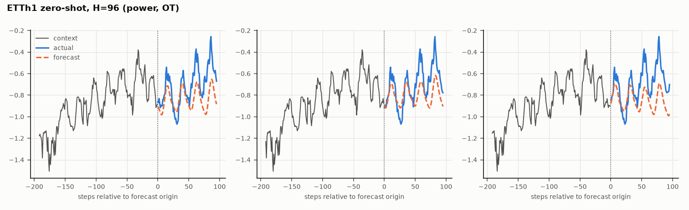
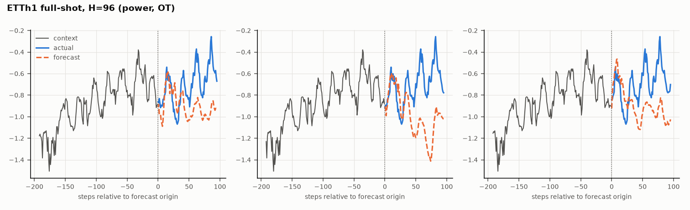

# TimeSqueeze / CutRule

A locally runnable implementation of the **TimeSqueeze** forecaster (`Papers/Time_Squeeze.pdf`), grown out of
`Test_Implementation.ipynb`, used to study one question: **how should a price series be cut into patches?**

TimeSqueeze is a foundation-model forecaster that compresses a long series into fewer tokens by cutting it into
variable-length patches. Here it is pretrained on Time-300B and fine-tuned on ORCL trades (regular session only):
the model reads each window's log price path and forecasts the next per-step log returns. Five ways of producing the
patch boundaries are compared:
- the paper's fixed **power rule**;
- a learned, bilevel-trained **CutRule**;
- three ways of letting forecast quality shape the patching.

Each method runs in two **timing variants**: the real, irregular tick timing (`time`) and ticks treated as evenly
spaced (`even`).

```
uv run python -m timesqueeze train-all --full      # every experiment, one after another (WSL, ~5 days on an RTX 5060)
```

**Contents**
1. [Status](#status), [Results of the full run](#results-of-the-full-run)
2. [The experiments at a glance](#the-experiments-at-a-glance)
3. [How the weights connect](#how-the-weights-connect-shared-and-separate-weights)
4. [Building blocks](#building-blocks): data, forecaster, patch rules, CutRule
5. [Training procedure, experiment by experiment](#training-procedure-experiment-by-experiment)
6. [Evaluation](#evaluation)
7. [Assumptions](#assumptions)
8. [Running it](#running-it), [Training everything](#training-everything), [Benchmarks](#benchmarks-ett-weather)
9. [Results files](#results-files), [Tests](#tests), [Review](#review), [Differences from the paper](#what-is-not-implemented-or-differs-from-the-paper), [Layout](#layout)

---

## Status

| Piece | Status |
|---|---|
| Test suite (100 tests) | **All pass in WSL2 with the real Mamba CUDA kernels on the RTX 5060** (driver 621.01): 85 fast (~2–5 min) + 15 end-to-end (~15 min with 1 worker) |
| Every experiment, end to end | Runs through `train-all` with the quick-test settings (all 14 stages) |
| Real Mamba layers (`mamba-ssm 2.3.2`, `causal-conv1d 1.6.2`, CUDA 12.8) | Work on the GPU: forward, backward, bf16, causal |
| Current setup | CutRule at the power rule's scale (bars of ~4 ticks, at most 8; a 120-epoch check on the ORCL training days reached 4.9 ticks), ORCL as the log price path with per-step log-return forecasts, regular session only. Earlier runs used percentage returns as the input, a CutRule that compressed ORCL ~40x and all-day trading hours; their outputs were deleted and nothing from them carries over |
| Earlier lessons kept | The first ORCL fine-tune at lr 1e-4 overfit within an epoch (validation loss 0.50 -> 0.60), so every ORCL phase uses **lr 1e-5**, validates **every 200 steps** and keeps the **best validation point** (before fine-tuning included) |
| Full `train-all` run | **Stages 1–13 done**; stage 14 (`benchmark-trilevel`) has only Weather full-shot left. Results below and in [`results/`](results/) |

---

## The experiments at a glance

All experiments use the same forecaster ([architecture](#the-forecaster-timesqueeze)), the same data, the same training
budget and the same evaluation. They differ **only in how patch boundaries are produced and how that rule is trained.**

| # | Experiment | Patch rule | How the patch rule learns | Command |
|---|---|---|---|---|
| 1 | **Power rule (staged)**, the paper's method | `\|x_t - x_{t-1}\| > 0.3 * sqrt(local power)`, max 8 ticks | fixed (no learning) | `finetune --patcher power` |
| 2 | **CutRule (staged)** | 4->6->1 MLP decides after each tick whether the bar ends | bilevel objective (bar duration + bar volatility); **frozen** while the forecaster trains | `finetune --patcher cutrule` |
| 3 | **Joint CutRule** (REINFORCE) | CutRule | bilevel objective + **forecast feedback by REINFORCE**, *during* both training phases | `joint` |
| 4 | **Three-level CutRule** | CutRule | duration and volatility as nested lower levels, forecasting as the leader (implicit differentiation through both) | `trilevel` |
| 5 | **Power rule, learned threshold** | power rule with `tau` chosen by a follower | `tau` = follower (forecast loss + 4x-compression target), forecaster = leader (bilevel, finite differences) | `power-bilevel` |
| B | **Benchmarks** | the backbones of 1 and 2, and the phase-A forecasters of 3 and 4 | (evaluation only) the paper's ETT / Weather zero-shot and full-shot tables | `benchmark` |

Every experiment except B runs twice, as `--spacing time` and `--spacing even`.

**Training budget, the same for every method:**

| Phase | Data | Steps | Batch | Context | Learning rate |
|---|---|---|---|---|---|
| Time-300B (pretraining) | 7.68B points, 1.87M series pieces | **5,000** | **64 windows** | 2048 (+64 targets) | AdamW 1e-3, 10% warm-up, cosine decay to 5e-5 |
| ORCL (fine-tuning) | 30 training days | **up to 5 epochs** over the same windows (best validation point kept) | **32 windows** (method 5: 16) | 512 (+64 targets) | AdamW **1e-5**, constant |

Methods 1, 2 and 5 do the Time-300B phase as backbone pretraining. Methods 3 and 4 do it as their own joint phase A.
Method 5 reuses method 1's backbone. Method 5's ORCL batch is 16 because each of its steps holds three gradient copies,
so it takes twice as many (smaller) steps over the same 5 epochs.

---

## How the weights connect (shared and separate weights)

```
                         TIME-300B PHASE  (shared by both spacings)            ORCL PHASE  (one per spacing)
                         ──────────────────────────────────────────            ─────────────────────────────────────────────
 power rule ───────────> backbone_power.pt ──────────────────────────────┬──> finetuned_power[_ticks].pt               (1)
                              │                                          └──> finetuned_power_bilevel[_ticks].pt       (5)
                              └──> benchmark: results/benchmarks/power/                                               (B)

 stage 1: CutRule on ──> cutrule_pretrained.pt ─┬─> backbone_cutrule.pt ──────> checkpoint[_ticks].pt  (ORCL CutRule) ┐
 Time-300B (dt = 1)                             │   (CutRule frozen)      └──> finetuned_cutrule[_ticks].pt  <───────────┘ (2)
                                                │        └──> benchmark: results/benchmarks/cutrule/                     (B)
                                                ├─> joint_pretrained.pt     (forecaster + CutRule, phase A) ──> joint[_ticks]_finetuned.pt     (3)
                                                │        └──> benchmark: results/benchmarks/joint/                       (B)
                                                └─> trilevel_pretrained.pt  (forecaster + CutRule, phase A) ──> trilevel[_ticks]_finetuned.pt  (4)
                                                         └──> benchmark: results/benchmarks/trilevel/                    (B)
```

- **Shared across the two spacing variants** (no `_ticks` suffix): `cutrule_pretrained.pt`, `backbone_power.pt`,
  `backbone_cutrule.pt`, `joint_pretrained.pt` and `trilevel_pretrained.pt`. Time-300B's files hold only values, no
  timestamps, so "real timing" and "evenly spaced" are the same thing there; training each twice would repeat
  identical work.
- **Separate per spacing variant** (`even` adds `_ticks`): everything trained on ORCL. That's the ORCL CutRule
  (`checkpoint[_ticks].pt`), the fine-tuned forecasters, method 5's model and learned `tau`, and phase B of methods 3 and 4.
- **Shared across methods:**
  - stage 1's CutRule is the starting point of method 2's backbone and of methods 3 and 4's phase A;
  - method 1's power backbone is the starting point of method 5;
  - the benchmarks score the backbones of methods 1 and 2 and the phase-A forecasters of methods 3 and 4.
- **Never shared:** a backbone is only used with the patch rule it was pretrained on (checked on load). Every
  checkpoint records the data, timing, patch rule and starting weights it was trained for, and refuses to load into a
  run that doesn't match.

---

## Building blocks

### Data

**ORCL trades** (`data/ORCL_trades_2024-07-02_to_2024-08-30.dbn.zst`). 638,865 trades over 43 trading days, from a
single exchange feed (Databento trades schema: executions only, no order-book events, exchange timestamps in feed order).
- **Regular session only:** trades between 09:30 and 16:00 New York time are kept, as in the bilevel tokenisation
  paper. The file also holds pre-market (from 04:00) and after-hours (to 20:00) trades: 11,664 (1.8%) are dropped,
  leaving 627,201.
- Returns are **log returns**, `log(p_i / p_{i-1})` between consecutive trades, computed **within each day's session**,
  so no return spans the overnight gap or the hours outside the session: 627,158 returns.
- The file cannot identify trades that were later cancelled or corrected (the paper removes those); they're kept.
- The split is by whole days: **30 train / 7 validation / 6 test**.
- Every window, context plus forecast targets, lies inside one trading day and one split.
- **Tick timing:** the gap between consecutive trades comes from the exchange timestamp `ts_event`, raw and never
  capped. 29% of gaps are exactly 0 ns, 59% are under 1 ms (median 0.20 ms), the mean is 1.6 s and the largest is
  1.9 hours (a long pause inside one session). Gaps are divided by one constant, the mean training-day gap, only so
  that rule hyperparameters written in "ticks" keep their meaning.

**Time-300B** (`data/Time-300B-subset`, `-subset2`, `-subset3`): 58,626 windows of 131,072 values, **7.68B points in 1.87M
series pieces, ~30 GB**.
- Sampled as in the paper: datasets weighted by size, with the three dominant Nature sources kept at 30%.
- The downloaded windows stitch several series together. `data/time300b_segments.py` recovers the true series
  boundaries from each dataset's `meta.json`, and training windows never cross a boundary.
- **Validation** holds out whole source `.bin` files (about 5%). Holding out single windows would leave the neighbouring
  windows of the same series in training.
- Pretraining uses every `Time-300B-subset*` folder it finds. `python -m timesqueeze download --gb 10` adds a further
  non-overlapping folder (needs `HF_TOKEN`).

**Benchmarks** (`data/benchmarks/`): ETTh1, ETTh2, ETTm1, ETTm2 and Weather. They're downloaded on first use from the
Time-Series-Library mirror on Hugging Face (see [Benchmarks](#benchmarks-ett-weather)).

### The forecaster (TimeSqueeze)

```
 series x [B,T] (z-normalised by context stats)             optional: elapsed time t [B,T], log-gap channel
        |                                                              |
        v                                                              v
 Linear(1->384) + Linear(1->384; zero-init, time channel) ---> SSM ENCODER: 2 x [LayerNorm -> Mamba] + residual
        |  fine-grained features e [B,T,384]       (d_state 128, d_conv 4, expand 4)
        |
        |--- patch starts from the PATCH RULE (power rule or CutRule; hard boundaries, CPU) ---+
        v                                                                                      |
 gather e at the patch starts -> tokens [B,P,384]                                              |
        v                                                                                      |
 MoE TRANSFORMER (causal), 12 layers, 12 heads, d_model 384                                    |
   each layer: RMSNorm -> attention with rotary positions = (elapsed) time of the patch start  |
               RMSNorm -> sparse MoE: 8 routed experts (top-2) + 1 sigmoid-gated shared expert |
        v                                                                                      |
 UNPATCH: repeat each token over its patch -> r [B,T,384] <-----------------------------------+
        v
 SSM DECODER: Linear(768->384) on [e ; r], then 2 x [LayerNorm -> Mamba] + residual
        v
 heads: Linear(384 -> h) for h in {1, 8, 32, 64}, applied at EVERY position (causal), zero-initialised;
        each outputs the next h scaled one-step CHANGES (level = last value + running sum)
```

- **Size:** 123.4M parameters: encoder 4.9M, MoE Transformer 113.3M (49.6M active), decoder 5.2M. The Transformer
  matches the paper's 113M / 50M. The Mamba parts are ~10M, against the paper's stated 4M.
- **MoE:** each layer has 8 routed experts (width 768, top-2) and one shared expert (width 1536).
  - The auxiliary loss `N * sum f_i r_i` (weight 0.02) penalises *imbalanced* routing.
  - An expert no token is routed to in a step gets no gradient, and the optimizer skips it that step.
  - The router and the shared expert always get gradients.
- **What the heads forecast:** the next one-step **changes** of the input series, divided by the RMS one-step change
  of the window's context (context only, so no future information in the scale). The level forecast is the last
  observed value plus their running sum. The heads start at zero, so an untrained model forecasts "no change".
  - On Time-300B the input is the series' levels (z-scored per window, as in the paper), and the heads forecast its
    changes.
  - On ORCL the input is the window's **log price path** (cumulative log returns, z-scored per window), so the changes
    the heads forecast are the **log returns**. Pretraining and fine-tuning therefore use one convention: a level
    series in, its next per-step changes out.
  - The ETT/Weather benchmarks are scored on the reconstructed levels, as in the paper.
- **Loss:** Huber (delta 2.0) between forecast and actual scaled changes, averaged over the four horizons and over
  every position whose targets lie inside the window, plus 0.02 × the aux loss.
- **Pretraining validation** also prints the loss of the **no-change** forecast (all changes 0), the baseline the
  pretrained model should beat.
- **Causality:** an output at time t depends only on inputs up to t:
  - patch starts use data up to themselves;
  - unpatching gives each tick the token of a patch that started at or before it;
  - attention is causal.

  This is tested. The per-window normalisation is the one documented exception (see [Assumptions](#assumptions)).
- **Time channel:** zero-initialised and unused on Time-300B (regular spacing), so pretraining leaves it inert.
  Fine-tuning with real timing teaches it ORCL's irregular gaps.

### The patch rules

- **Power rule** (paper): a boundary at tick `i` if `|x_i - x_{i-1}| > tau * sqrt(mean(x[i-32:i]^2))` (tau = 0.3), or if
  the patch reaches 8 ticks.
  - The time-aware version averages the power over the last 32 *time units* and also closes a patch after 8 time units.
  - For evenly spaced ticks it equals the paper's rule exactly (tested).
  - On Time-300B it compresses ~2.5x; on the ORCL log price path ~5.3–5.6x (the paper reports 4x on its data mix).
    (On ORCL returns, the input before this change, it was only ~1.9x.)
- **CutRule:** a 4 -> 6 (tanh) -> 1 MLP decides after every tick whether the current bar (patch) ends.
  - Its four inputs: volatility accumulated since the bar began, the bar's duration **in ticks**, and slow and fast
    EWMA volatility (spans 50 / 10; time-aware in the `time` variant, which is the only place tick timing enters).
  - It aims for bars of **4 ticks** on average (about the paper's 4x compression) and a bar always ends after
    **8 ticks**, the power rule's cap, so both rules hand the backbone about the same number of tokens and differ in
    *where* they cut. (Before this, the CutRule aimed for 20 time units with no cap and compressed ORCL ~40x, leaving
    the Transformer ~13 tokens per 512-tick window.)
  - A bar always ends at the end of a trading day or series.
  - At train and test time the rule is deterministic (cut when the logit ≥ 0). Methods 3 and 4 also sample from it
    (cut with probability `sigmoid(logit / 0.5)`).

### The CutRule's bilevel objective (`cutrule/model.py`, `cutrule/bilevel.py`)

This is a leader-follower problem on a *soft* version of the rule, in which each tick cuts with probability
`sigmoid(logit / temp)`. That makes the expected bar duration `d` and bar variance differentiable.
- **Follower:** the cut threshold `b2`. It minimises `var(log d) + (mean log d - log 4)^2`, plus a proximal term, so
  bars last about **4** ticks. It's solved by damped Newton with a line search. The soft bar also ends at 8 ticks, so
  the expected duration matches the capped hard rule.
- **Leader:** the remaining weights. They minimise `var(log sigma_bar) + (mean log sigma_bar - log sigma_target)^2 + 5 *
  (log cut-rate - log 1/4)^2`: bars of even volatility, near a target level, within a cut-rate budget. The leader takes
  the gradient *through* the follower's response (implicit function theorem), clipped to unit norm, with Adam at 1e-2.
- **Volatility units:** `sigma_target = std(returns) * sqrt(4)`, the volatility of a typical 4-tick bar, where `std` is
  the return scale the rule is built on (the ORCL training log returns; Time-300B increments are scaled to match). The
  feature scales are tied to it too (accumulated volatility / `sigma_target`, duration / 4, EWMA / `std`), so the
  initial rule already cuts near the target. The scale is saved with the weights. (The bilevel paper's fixed 0.02 was
  for returns rescaled to its synthetic data; on raw ORCL returns, std ~1.6e-4, it was ~30x too large and pushed bars
  to be very long.)
- A finished run must leave a rule that cuts on its own somewhere (checked after 10+ epochs); cuts forced by a day's
  end or by the 8-tick cap don't count, so a rule that never cuts by itself is caught. An update that leaves no bars
  at all is rolled back. In methods 3 and 4, ticks where the cap ended a bar took no decision and are left out of the
  REINFORCE log-probability.

---

## Training procedure, experiment by experiment

The stages below are what `train-all` runs. "Shared" means trained once and reused by both spacings.

### Stage 1, shared: the CutRule on Time-300B (`pretrain-cutrule`, used by methods 2, 3 and 4)
- **Data:** 800 random Time-300B series pieces of 1,024 points (~810k points). Each piece is its own "day".
- **Transform:** Time-300B values aren't returns, so each series becomes its increments, scaled so their standard
  deviation equals that of the **ORCL training log returns**. The CutRule's volatility thresholds therefore see
  ORCL-sized numbers.
- **Timing:** every tick is 1 time unit apart (no timestamps exist).
- **Training:** 60 bilevel epochs. If an initialisation never cuts, the next seed is tried (up to 5).
- **Output:** `cutrule_pretrained.pt`.

### Method 1: power rule, staged (`finetune --patcher power`)
1. **Backbone pretraining** (shared, `backbone_power.pt`):
   - a randomly initialised forecaster trained on power-rule patches of Time-300B windows;
   - each window is drawn from inside one series, with probability proportional to series length, and z-normalised
     by its context;
   - 5,000 steps × 64 windows × 2048 context, AdamW 1e-3 (weight decay 0.1, betas 0.9/0.95), 10% warm-up then cosine
     decay to 5e-5;
   - bf16, gradient clipping 1.0;
   - validation loss on held-out source files every 250 steps, and a rolling checkpoint every 100 steps.
2. **Fine-tuning on ORCL** (per spacing, `finetuned_power[_ticks].pt`):
   - context-512 windows every 16 ticks across the 30 training days;
   - 5 epochs at 32 windows per step, AdamW 1e-5 (constant; the paper's 1e-4 overfit ORCL within the first epoch);
   - validation every 6,400 windows (200 steps); the best point is kept;
   - power rule on each normalised context (the log price path);
   - in the `time` variant, the rule, the rotary positions and the time channel use the real gaps.
3. **Evaluation:** test days, [as below](#evaluation).

### Method 2: CutRule, staged (`finetune --patcher cutrule`)
1. **Stage 1** (shared): the Time-300B CutRule.
2. **Backbone pretraining** (shared, `backbone_cutrule.pt`): exactly as in method 1, except each window is patched by
   the **frozen** stage-1 CutRule, applied to the window's increments with the same transform.
3. **Stage 3, ORCL CutRule** (per spacing, `checkpoint[_ticks].pt`):
   - starts from the stage-1 CutRule and runs 30 bilevel epochs on the raw log returns of the 30 training days;
   - durations are tick counts in both variants; the `time` variant's EWMA volatility uses the real gaps;
   - this rule is then frozen.
4. **Fine-tuning on ORCL** (per spacing): as in method 1. The ORCL CutRule reads the window's raw log returns (its
   EWMA features computed on the full series and restarted each day), and its cuts are applied to the log price path
   the model sees (the same tick indices).
5. **Evaluation:** as below.

### Method 3: joint CutRule with REINFORCE (`joint`)
Same two phases and budgets as method 2. The difference is that the CutRule **keeps learning from forecast quality
during both phases**, instead of being frozen.

1. **Phase A on Time-300B** (shared, `joint_pretrained.pt`):
   - the forecaster starts from random weights (like method 2's backbone), the CutRule from the stage-1 CutRule;
   - 5,000 steps × 64 windows × 2048 context, with the same learning-rate schedule as backbone pretraining.
   - **Forecast feedback, every step:**
     - the CutRule cuts each window stochastically, **twice** (K = 2 patchings);
     - both patchings go through the forecaster;
     - the one with the lower forecast loss has its cut decisions reinforced:
       `grad = E[(loss_k - mean_k loss) * grad log p(cuts_k)]`.
     - Comparing two patchings of the *same* window cancels out how hard the window is.
     - Advantages are scaled by a running average, and the CutRule takes Adam steps at 1e-3.
     - Patchings are sampled in the main process from the CutRule *as it is now* (on-policy).
   - **Keeping bars sensible:** forecast loss alone always prefers more tokens, so each of the 20 rounds (250 steps
     each) also runs 3 bilevel epochs of the original objective on fresh Time-300B series.
   - Validation loss on held-out Time-300B files, with the CutRule's deterministic patches, every round.
2. **ORCL CutRule adaptation** (per spacing): 30 bilevel epochs on the training days from the phase-A CutRule, as in
   method 2's stage 3.
3. **Phase B on ORCL** (per spacing, `joint[_ticks]_finetuned.pt`):
   - 5 epochs over the same training windows as `finetune`, 32 windows per step, lr 1e-5, the same validation schedule;
   - the CutRule keeps learning by REINFORCE, with 3 bilevel epochs on the training days each epoch.
4. **Evaluation:** identical to `finetune`, with the final CutRule used deterministically.

*Cost:* every window is forecast twice, so each step does twice the forecaster work of methods 1 and 2.

### Method 4: three-level CutRule (`trilevel`)
The same phases, budgets and REINFORCE signal as method 3. The CutRule, though, is a **follower-follower-leader**
problem (`cutrule/trilevel.py`):

| Level | Controls | Objective |
|---|---|---|
| 1 (innermost) | the threshold bias `b2` | bar duration |
| 2 | the readout `W2` | bar volatility |
| leader | the hidden layer | forecast quality |

- Levels 1 and 2 are re-solved at **every step** on a small corpus of the current phase's data (Time-300B series in
  phase A; the first 2 training days in phase B).
- The leader's REINFORCE gradient is carried *through* both solutions by implicit differentiation (nested Newton steps).
  So forecast quality can only move cuts around under the duration and volatility conditions. That's also what stops
  "more tokens always forecast better" from winning, which method 3 handles with extra bilevel epochs instead.
- The hypergradient matches finite differences on a toy problem. On the real objectives it's only checked for
  consistency and finiteness.

### Method 5: power rule with a learned threshold (`power-bilevel`)
- **Starting point:** method 1's backbone (`backbone_power.pt`), fine-tuned on ORCL (per spacing) for 5 epochs at
  lr 1e-5, 16 windows per step, validating every 6,400 windows like `finetune`.
- **Follower:** `tau`. Given the forecaster, it minimises
  `L(theta, tau) + 1.0 * (log c(tau) - log 4)^2 + 1.0 * (tau - tau_prev)^2`:
  - the forecast loss on the batch patched with `tau`,
  - plus a pull toward the paper's 4x compression `c`,
  - plus a proximal term.

  It's solved each step by a golden-section search within ±0.25 of the previous `tau` (bounded to [0.02, 3]).
- **Leader:** the forecaster. It minimises `L(theta, tau*(theta))`, and its gradient adds the implicit term
  `-(dL/dtau) / (d2f/dtau2) * d2f/(dtau dtheta)`, i.e. it anticipates how `tau` will re-tune to it.
- **Derivatives in `tau`:** boundaries are hard, so these are central finite differences on one fixed batch. The step is
  25% of `tau`; a fixed small step sees ORCL's loss as flat. Each step costs ~14 forward and 3 backward passes (~2 s).
- **What to expect on ORCL:**
  - on the log price path, `tau = 0.3` compresses ~5.3–5.6x and `tau = 0.1` ~3.2x, so the 4x target sits between them;
    boundaries react to `tau` in that range, so the forecast loss can pull on it too.
- **Evaluation:** with the learned `tau`, which is saved together with its history.

### B: benchmarks (`benchmark`, on the backbones of methods 1 and 2 and the phase-A forecasters of 3 and 4)
- **Zero-shot:** the pretrained backbone, never trained on the benchmark, forecasts 96 / 192 / 336 / 720 steps.
- **Full-shot:** a fresh copy of the backbone is first fine-tuned for 1 epoch at lr 1e-4 on the benchmark's train split.
  This is the paper's protocol, kept so the numbers compare with its Table 2; ORCL uses 1e-5.

- **Methods 3 and 4** (`--patcher joint`, `--patcher trilevel`): their phase-A forecaster (`<joint|trilevel>_pretrained.pt`),
  patched by the CutRule it learned alongside, cutting greedily as in phase A's validation.

See [Benchmarks](#benchmarks-ett-weather) for the protocol.

---

## Evaluation

All ORCL experiments are scored identically, on the **6 held-out test days**:
- **Windows:** context 512, one window every 64 ticks, never crossing a day.
- The model sees each window's **log price path**, normalised by its context's mean and standard deviation, and
  forecasts the next one-step changes, which are the **next log returns**. The forecast is taken from the **last
  position**, where the whole context is in the past.
- **Metrics:** for each horizon h ∈ {1, 8, 32, 64}, the MSE and MAE of the h **per-step log-return** forecasts (not
  cumulative returns), averaged over the h steps, in units of the context's RMS log return. Two baselines:
  - the **zero forecast** (every future log return 0: no change, the random walk);
  - the **context-mean forecast** (every future log return equals the context's mean: its drift continues).

  An MSE below both means the model forecasts returns better than either simple rule.
- **Saved results:** `forecasts.csv` holds each forecast step in these units and as the actual log return;
  `metrics.json` and the figures report the per-step log-return errors next to both baselines.
- **Compression** = ticks per patch on the test windows.
- **Windows are identical across methods:** the same windows go to every method and both spacing variants, so the
  numbers are directly comparable.
- **Validation and model selection:** every 6,400 training windows (200 steps at 32 windows, ~5 times per epoch) and at
  the end of each epoch, the model is scored on the 7 validation days. The weights of the **best validation point** are
  the ones evaluated on the test days.
  - The model before any ORCL training is a candidate too, so fine-tuning can't make the selected model worse on the
    validation days.
  - Methods 3 and 4 keep the CutRule from that same point, and method 5 keeps that point's `tau`.
  - **Why:** in the first full run, at the paper's lr 1e-4, the best point was epoch 1 (val 0.503 vs 0.505 before
    fine-tuning). After that, validation loss rose every epoch while training loss fell: overfitting. So ORCL now uses
    lr 1e-5 with frequent validation.

---

## Assumptions

Every choice below affects the results. They're listed so they can be questioned.

**Data and timing**
1. **Regular session only, returns within a day.** Only trades between 09:30 and 16:00 New York time are used. No
   return, window or bar spans the overnight gap or the hours outside the session; days are split whole into
   30 / 7 / 6. Trades later cancelled or corrected can't be identified in the file and are kept.
2. **Tick gaps are used raw.** `ts_event` gaps are never capped, clipped or redefined. They're only divided by one
   constant (the mean training-day gap) so that time-based settings (the power rule's 32-unit window and 8-unit cap in
   the `time` variant, the EWMA spans) mean about as many average ticks.
3. **Time-300B is evenly spaced at its own rate.** It has no timestamps, so every tick is 1 unit apart. This is why its
   stages are shared by both spacing variants. Both variants' ORCL CutRules start from the same stage-1 CutRule.
4. **The CutRule sees Time-300B as returns.** Its series are turned into increments scaled to the standard deviation
   of the ORCL training log returns, so the volatility targets carry over between the two datasets.
5. **ORCL is modelled as a price path.** The forecaster reads each window's log price path (cumulative log returns
   from the window's start) and forecasts its next one-step changes, i.e. the log returns; the CutRule reads the log
   returns themselves.

**Normalisation and causality**

6. **Per-window z-scoring with the context's statistics** (as in the paper and Time-MoE).
   - Forecast changes are scaled by the context's RMS one-step change (RMS rather than standard deviation, so a
     straight-line context still has a scale), and ORCL scores are per-step log returns in those units.
   - Because the statistics use the whole context, early positions of a window depend weakly on later points of the
     same window.
   - The test metric forecasts from the last position, so it isn't affected.
   - The ORCL CutRule uses raw log returns and causal, per-day statistics.

**Training**

7. **Equal budgets.** Every method gets 5,000 Time-300B steps × 64 windows and 5 ORCL epochs over the same windows at
   lr 1e-5. Methods 3 and 4 spend twice the compute per step (two patchings), and method 5 uses smaller steps.
8. **5,000 steps is far below the paper's budget.** That's 0.66B Time-300B points seen, against the paper's ~52B
   (100k steps × 256 windows). Absolute scores will be worse than the paper's; the comparison between methods is what
   this setup can show.
9. **One seed (0) per run.** There are no repeats and no error bars, so small differences between methods may be noise.
10. **Model selection on the validation days.** Every method is evaluated with its best validation point (checked every
   200 steps and at each epoch's end; before fine-tuning included). The test days are never used for any choice.
   The fine-tuning rate (1e-5) was chosen after seeing the first run's validation curve, not its test scores.
11. **Both spacing variants use the same hyperparameters.** CutRule durations are tick counts in both; the variants
    differ in the EWMA volatility features, the power rule's time-aware window, and the forecaster's timing inputs.

**Method-specific**

12. **CutRule targets:** bars of about 4 ticks (at most 8), bar volatility near `std(returns) * 2`, and a cut-rate
    budget weight of 5. These are fixed and not tuned per method.
13. **Methods 3 and 4:** two sampled patchings per window, a running advantage scale, and CutRule learning rate 1e-3.
    Method 4's lower levels are solved on a small corpus, not the whole phase's data.
14. **Method 5:** a 4x compression target, compression and proximal weights of 1.0, a finite-difference step of 25% of
    `tau`, and a search within ±0.25 of the last `tau`. The forecast loss is measured on one batch per step.

**Benchmarks**

15. The rolling schedule (longest head that fits) follows Time-MoE's description; the paper doesn't spell it out.
    Scores are in the benchmark's scaled units, as in the reference code.

---

## Running it

Everything runs in **WSL2** (Ubuntu 24.04); the Mamba CUDA kernels only exist for Linux.
- **Folders:** the project lives at `~/timesqueeze` (`/root/timesqueeze`), a git clone of this repo, together with all
  the data. Open it in VS Code with the WSL extension (`code ~/timesqueeze`).
- **Data backups:** all data (~31 GB) is **only** in `~/timesqueeze/data`, inside WSL's virtual disk; unregistering the
  distro deletes it. Subsets 2 and 3 can be re-downloaded, but the first Time-300B subset and the ORCL file can't be
  regenerated exactly.

```
cd ~/timesqueeze && uv sync                       # PyTorch 2.9 / cu128 + prebuilt mamba-ssm / causal-conv1d wheels
uv run python -m timesqueeze check-mamba          # forward + backward + bf16 + causality on the GPU
```

One command line, `python -m timesqueeze <command>`. `--help` lists the commands; `<command> --help` shows a command's
options.

| command | what it does |
|---|---|
| **`train-all`** | **every experiment, one stage after another** (next section) |
| `pretrain-cutrule` | stage 1: CutRule on Time-300B -> `cutrule_pretrained.pt` (shared) |
| `pretrain` | backbone on Time-300B -> `backbone_<patcher>.pt` (shared) |
| `train-cutrule` | stage 3: CutRule on the ORCL training days -> `checkpoint[_ticks].pt` |
| `finetune` | methods 1 / 2: fine-tune + evaluate; **runs every missing earlier stage first** |
| `joint`, `trilevel` | methods 3 / 4: phase A if missing, ORCL CutRule adaptation, phase B, evaluation |
| `power-bilevel` | method 5 |
| `benchmark` | ETT / Weather zero-shot and full-shot for one backbone |
| `check-mamba`, `download`, `index` | GPU smoke test, more Time-300B data, rebuild the series index |

**Quick-test mode is the default everywhere.** Every stage runs for one epoch or step on tiny data, writes to
`outputs/quick/` (so its meaningless weights can never be mistaken for real ones), and takes about a minute. Pass
`--full` for a real run.

The ORCL commands take `--spacing time|even|both` (default `both`), and `finetune`, `pretrain` and `benchmark` take
`--patcher cutrule|power`.

In VS Code: open `run.py`, set `TASK` (default `"train-all"`), `QUICK_TEST`, `PATCHER` and `SPACING`, and press Run.
Start long runs in `tmux` so closing the terminal doesn't stop them.

**Speed (measured on an RTX 5060 Laptop, 8 GB):**
- **Throughput:** the GPU is the limit. The micro-batch is found automatically, using at most half the GPU's memory
  (usually 1 or 2 windows, accumulated to 64); a power-rule pretraining step took 5.4 s at micro-batch 2 and 7.8–10 s
  at micro-batch 1, depending on the laptop's power mode and temperature.
- **Reach:** one full pass over the 7.68B points would take ~85 h. The paper's ~52B points aren't reachable on this
  machine.
- **Data side:** negligible. A CutRule patching of a 2,048-tick window takes 0.12 ms (compiled with numba); the power
  rule takes 0.03 ms.
- **Optimisations in place:**
  - bf16 autocast, TF32 and fused AdamW;
  - fused attention and compiled scans;
  - windows built on the GPU and GPU-side loss accumulation;
  - MoE routing with one host sync per layer.

**Checkpoints:**
- Each run keeps one rolling checkpoint (each save replaces the last): `pretrain_ckpt_<patcher>.pt`,
  `checkpoint[_ticks].pt`, `finetune_<tag>_ckpt.pt`, `<joint|trilevel>_pretrain_ckpt.pt`,
  `<joint|trilevel>[_ticks]_finetune_ckpt.pt` and `power_bilevel[_ticks]_ckpt.pt`.
- An interrupted run **continues from it automatically** the next time the same command runs; `--restart` starts over.
- **All weights and checkpoints (`outputs/`, `*.pt`) are gitignored.**

## Training everything

```
uv run python -m timesqueeze train-all --full          # in tmux; or run.py, whose TASK defaults to "train-all"
```
`train-all` runs every stage in sequence, each as its own process.
- A failing stage doesn't stop the others.
- Each stage logs to `outputs/logs/<stage>.log`, and progress is recorded in `outputs/train_all_status.json`.
- Running the same command again skips finished stages; that's how to continue after an interruption.
- `--redo` reruns finished stages, and `--only` / `--skip` pick stages.
- `--pretrain-steps N` changes the Time-300B budget for every method at once.
- `--bench-stride 1` gives the paper's full benchmark protocol, about 4x longer than the default of 4.

| # | stage | what it trains | estimated time |
|---|---|---|---|
| 1 | `finetune-cutrule-time` | stage 1, cutrule backbone (5,000 steps), ORCL CutRule, fine-tune, evaluate | ~8–14 h |
| 2 | `finetune-power-time` | power backbone (5,000 steps), fine-tune, evaluate | ~8–14 h |
| 3 | `finetune-cutrule-even` | reuses stage 1 and the backbone; `even` ORCL CutRule, fine-tune | ~1 h |
| 4 | `finetune-power-even` | reuses the power backbone; fine-tune | ~1 h |
| 5–6 | `power-bilevel-time`, `-even` | method 5, 5 epochs | ~5 h each |
| 7–8 | `benchmark-cutrule`, `benchmark-power` | ETT / Weather zero- and full-shot, every 4th window | several h each |
| 9 | `joint-time` | method 3: phase A (5,000 steps, two patchings each), adaptation, phase B | ~20+ h |
| 10 | `joint-even` | reuses phase A; adaptation, phase B | ~2 h |
| 11 | `trilevel-time` | method 4: as 9, with the lower levels re-solved every step | ~20+ h |
| 12 | `trilevel-even` | reuses phase A | ~2 h |
| 13–14 | `benchmark-joint`, `benchmark-trilevel` | ETT / Weather zero- and full-shot on the phase-A forecasters of 3 and 4 | ~9 h each |

**About 5 days in total.** Only the power-rule pretraining speed is measured; the other times are estimates. The
CutRule now compresses ~4–5x instead of ~20–40x, so its backbone and methods 3 and 4 hand the Transformer about as
many tokens as the power rule and run at about its speed (slower than before).

### Pausing and resuming

- **To pause:** press **Ctrl+C** in the tmux window (`tmux attach -t train`), or close the session
  (`tmux kill-session -t train`). Rebooting or shutting WSL down (`wsl --shutdown`) also works.
- **To resume:** run the **same command** again: `uv run python -m timesqueeze train-all --full`.
  - Finished stages are skipped, according to `outputs/train_all_status.json`.
  - The interrupted stage continues from its last rolling checkpoint.
- **How much is lost:** at most a few minutes, or one epoch. Checkpoints are saved
  - every 100 steps of backbone pretraining (~8 min),
  - every 50 steps of methods 3 and 4's phase A (~8 min),
  - every 10 epochs of a CutRule stage,
  - after every epoch of an ORCL phase (fine-tuning, methods 3/4 phase B), and at method 5's validation points,
  - after every dataset and mode of a benchmark.
- **The checkpoint must match the run:** each one records exactly what it was written for (patch rule, spacing,
  backbone, settings). One that doesn't match is ignored, and that phase starts over.
- **Sleep:** don't let the PC sleep during a run. Once, after the laptop slept with its lid closed, the training
  process hung on wake (CPU busy, GPU idle, no new log lines) and had to be stopped and resumed. While plugged in, set
  Windows sleep to "Never" and closing the lid to "Do nothing".
- **Crashes:** a Windows crash or reboot (this laptop has had NVIDIA `0x113` bugchecks during long runs) stops the
  run like a pause; resuming continues from the last checkpoint.
- **Starting over:** `--redo` reruns finished stages from scratch. To redo a single stage, delete its entry from
  `train_all_status.json` and its output files, or use `--only <stage> --redo`.

## Benchmarks (ETT, Weather)

`benchmark` scores a pretrained backbone the way the paper does (sections 4.1 and 4.2, Tables 1 and 2):
- **Data:** ETTh1, ETTh2, ETTm1, ETTm2 and Weather, downloaded once to `data/benchmarks/` from the Time-Series-Library
  mirror on Hugging Face (`thuml/Time-Series-Library`).
- **Protocol:** that library's `data_loader.py`:
  - ETT splits are 12 / 4 / 4 months; Weather is 70 / 10 / 20 %;
  - a per-channel scaler is fitted on the train split;
  - every channel is its own series;
  - windows at stride 1, where each horizon has its own window set and test contexts reach back into the validation
    rows.
- **Settings:** context 512, horizons 96 / 192 / 336 / 720; MSE and MAE in scaled units.
- **Patching:** the benchmarks are evenly spaced, so they're patched exactly as Time-300B was during pretraining.
- **Horizons past the 64-step head:** forecasts are rolled.
  - Each roll uses the longest head that fits, appends its forecast and goes again (720 = 11 × 64 + 2 × 8).
  - Patches are recomputed on every roll, and the original context's scale is kept.
  - One rollout to 720 serves all four horizons.
- **Output:** `outputs/results/benchmarks/<patcher>/` holds `results.csv` (with the paper's TimeSqueeze-base numbers
  beside ours), `metrics.json`, one MSE-by-horizon figure per dataset, and example forecasts for every dataset, mode
  and horizon (96, 192, 336, 720).
- **Levels from changes:** the heads forecast scaled one-step changes; each roll turns them into levels (last value
  plus running sum, scaled by the original context's RMS change), and the benchmarks are scored on those levels.

## Results of the full run

Every figure, metric and CSV from the full run is copied to [`results/`](results/) (the same layout as
`outputs/results/`, without weights or checkpoints).

**ORCL test days** (`results/<run>/metrics.json`). MSE of the per-step log-return forecasts in units of the context's
RMS log return (the zero forecast scores ~1), on the same 200 of the 922 test windows. Compression is ticks per patch.

| Method | Spacing | Compression | h = 1 | h = 8 | h = 32 | h = 64 |
|---|---|---|---|---|---|---|
| 1 Power rule, staged | time | 4.1x | 1.019 | 1.005 | 0.948 | 0.939 |
| 1 Power rule, staged | even | 4.8x | 1.032 | 0.986 | 0.937 | 0.933 |
| 2 CutRule, staged | time | 5.4x | 1.023 | 0.997 | 0.940 | 0.934 |
| 2 CutRule, staged | even | 5.1x | 1.009 | 0.987 | 0.937 | 0.933 |
| 3 CutRule, joint (REINFORCE) | time | 3.1x | 1.009 | 0.986 | 0.936 | 0.933 |
| 3 CutRule, joint (REINFORCE) | even | 3.4x | 1.021 | 0.984 | 0.935 | 0.932 |
| 4 Three-level CutRule | time | 8.0x | 1.029 | 0.988 | 0.938 | 0.933 |
| 4 Three-level CutRule | even | 8.0x | 1.099 | 1.003 | 0.942 | 0.936 |
| 5 Power rule, learned `tau` | time | 3.0x | 1.025 | 0.993 | 0.943 | 0.936 |
| 5 Power rule, learned `tau` | even | 3.7x | 1.007 | 0.983 | 0.936 | 0.932 |
| Zero-return forecast | | | 0.961 | 0.969 | 0.929 | 0.929 |
| Context-mean forecast | | | 0.963 | 0.972 | 0.931 | 0.930 |

- **No method beats the zero-return forecast at any horizon.** The gap is largest at h = 1 and almost gone at h = 64,
  and the differences between methods are small next to it.
- **Method 4's CutRule ends at 8.0x in both variants:** every patch runs to the 8-tick cap, so it no longer chooses
  its cuts.

**ETT / Weather benchmarks** (`results/benchmarks/<backbone>/`, every 4th test window). Test MSE at H = 96 on the
scaled data; the paper's TimeSqueeze-base zero-shot number for comparison (Table 1).

| Dataset | Mode | Power (1) | CutRule (2) | Joint (3) | Three-level (4) | Paper |
|---|---|---|---|---|---|---|
| ETTh1 | zero-shot | 0.382 | 0.376 | 0.649 | 0.430 | 0.359 |
| ETTh2 | zero-shot | 0.285 | 0.285 | 0.297 | 0.288 | 0.282 |
| ETTm1 | zero-shot | 0.402 | 0.391 | 0.658 | 0.435 | 0.312 |
| ETTm2 | zero-shot | 0.201 | 0.200 | 0.196 | 0.199 | 0.181 |
| Weather | zero-shot | 0.184 | 0.184 | 0.184 | 0.177 | 0.167 |
| ETTh1 | full-shot | 0.479 | 0.449 | 0.483 | 0.452 | |
| ETTh2 | full-shot | 0.329 | 0.309 | 0.321 | 0.301 | |
| ETTm1 | full-shot | 0.389 | 0.343 | 0.383 | 0.369 | |
| ETTm2 | full-shot | 0.211 | 0.198 | 0.210 | 0.216 | |
| Weather | full-shot | 0.205 | 0.186 | 0.215 | (running) | |

- **Short horizons are close to the paper** for the staged backbones (methods 1 and 2): within ~0.02 zero-shot on
  ETTh1, ETTh2, ETTm2 and Weather, and ~0.08–0.09 worse on ETTm1. The joint backbone is much worse on ETTh1 and ETTm1.
- **Long horizons diverge.** Beyond 64 steps the forecast is rolled forward (11 rolls for H = 720), and at H = 336 and
  720 the error grows by orders of magnitude on most datasets, so averages over horizons aren't meaningful (see each
  `results.csv`).
- **Full-shot doesn't consistently beat zero-shot at H = 96:** it's worse on ETTh2 for every backbone and on ETTh1
  for all but the joint one, and better on ETTm1 for all four. The paper's single epoch at lr 1e-4 may not suit these
  backbones.

Example forecasts (three test windows of ETTh1's oil-temperature channel; power-rule backbone):




## Results files

- **ORCL experiments:** each writes to `outputs/results/<run>/`. The run names are `cutrule`, `power`, `power_bilevel`,
  `joint` and `trilevel`, each plus `_ticks` for the `even` variant. Each folder holds:
  - `forecasts.csv`: actual vs forecast for every test window, horizon and step;
  - `metrics.json`;
  - `history.csv`;
  - figures: `mse_by_horizon.png`, `forecast_examples_h1.png`, `_h8`, `_h32` and `_h64` (per-step log returns),
    `patch_boundaries.png`, `patch_sizes_<rule>.png` and the loss curves.
- **Benchmarks:** `outputs/results/benchmarks/<patcher>/` holds `metrics.json`, `results.csv`, `mse_<dataset>.png` and
  `forecasts_<dataset>_<mode>_H<H>.png` for every dataset, mode (zero-shot / full-shot) and horizon (96 to 720).
- **Method 5** also saves `tau_history.csv` and `tau_and_compression.png`.
- **Tests:** every test saves its results and figures to `outputs/test_results/<test name>/`.
- **In git:** `outputs/` is ignored. The full run's `outputs/results/` is copied to `results/` (figures, metrics and
  CSVs only; weights, checkpoints and a benchmark's in-progress `partial_*` files are never committed).

## Tests

```
uv run python -m pytest -q -n 3 -m "not slow"      # 84 tests: everything except the end-to-end runs; ~2-5 min
uv run python -m pytest -q -n 1 -m slow            # 15 end-to-end runs; ~15-25 min (1 worker: least GPU and RAM)
uv run ruff check .                                # lint (unused names, import order)
```
`conftest.py` uses the real `mamba_ssm.Mamba` when it's installed (otherwise a causal stand-in). It forces exact fp32
matmuls (TF32 made padded-vs-unpadded outputs differ by 2.7e-4 instead of 1.8e-7) and gives every test an artifact
folder.

**GPU memory:** the batch-size probe now targets at most half the GPU, and ORCL steps run in micro-batches of 8 windows. Earlier, power-rule pretraining grew from 4.1 GB in the probe to 7.4 GB in
training. At that point the WSL driver started paging GPU memory to system RAM, and a step took 30 s instead of 5 s.
PyTorch's `expandable_segments` allocator option is deliberately left off. It goes through CUDA's virtual-memory calls,
which WSL passes to the Windows graphics kernel, and a run with it ended in a Windows crash (bugcheck 0x113,
`VIDEO_DXGKRNL_FATAL_ERROR`). Keep the NVIDIA driver and WSL (`wsl --update`) current for long runs.

Run the slow tests with at most 2 workers. Three end-to-end runs at once can exhaust the 8 GB GPU, and the WSL GPU
driver then kills a worker (`dxgkio_make_resident: Ioctl failed: -12`).

- **`test_patching.py`**: the power rule is identical to the notebook's reference. Also covers EWMA, the CutRule
  segmenter against the model, regular-session-only trades, log returns, per-day returns and splits, untouched raw
  tick gaps, windows and bars never crossing a day, and the time-aware rules reducing to the paper's for regular ticks.
- **`test_model.py`**: the paper's parameter counts, causality, padding invariance and loss masking; an untrained model
  forecasts no change; the per-step targets and level reconstruction are exact and use the context only; a training
  step learns; the time channel is inert at init; the **real Mamba layer** is causal, with finite gradients, in bf16.
- **`test_cutrule_ticks.py`**: the CutRule's 4-tick target, 8-tick cap (hard and soft), tick-count durations,
  volatility units saved with the weights, and REINFORCE ignoring ticks where the cap ended a bar.
- **`test_step_forecasts.py`**: the ORCL input is the z-scored log price path, the targets convert back exactly to log
  returns, and the saved forecasts are per-step log returns.
- **`test_equivalence.py`**: the optimised code equals plain reference implementations (compiled scans, vectorised
  collation, sorted MoE routing, GPU windows, the dataset index), and the bilevel training recovers from a collapsed
  update.
- **`test_trilevel.py`**: method 4's hypergradient against finite differences (toy problem, three starting points) and
  lower-level optimality.
- **`test_stages.py`**: methods 1 and 2 end to end for both spacings; the two spacings **share** the Time-300B CutRule
  and backbone (the second run retrains nothing) but **not** their ORCL models (which differ).
- **`test_joint.py`**: REINFORCE pushes down the worse patching; sampled patchings match the policy; methods 3 and 4 end
  to end for both spacings, with phase A trained once and shared.
- **`test_power_bilevel.py`**:
  - the golden-section follower;
  - the implicit `tau` hypergradient against finite differences on a problem with a closed-form `tau*`;
  - unused weights getting no gradient;
  - `tau` moving boundaries and the loss on a real ORCL batch;
  - method 5 end to end.
- **`test_benchmarks.py`**: splits and window sets equal the Time-Series-Library's; the head schedule and rolling
  forecast (a no-change stand-in reproduces the last value over 720 steps); ETTh1 scaling; zero- and full-shot end
  to end.
- **`test_train_all.py`**: the stage plan, and that failures don't stop the run and finished stages are skipped.
- **`test_review_fixes.py`**: one test per confirmed finding of the independent code review.

Not covered: any claim that one method forecasts better than another, and full-size training.

## Review

An independent review of the model code found real bugs, all fixed with a test each:
- the collapse guard never fired on multi-day data;
- my first fix for that was too strict (a hard rule that momentarily cuts nothing is normal; now the *finished* rule is
  checked);
- the method-4 hypergradient was evaluated away from the solved point;
- REINFORCE sampled off-policy;
- Time-300B validation leaked neighbouring windows;
- interrupted CutRule checkpoints were reused as finished;
- the batch-size probe ignored optimizer memory;
- backbone and resume didn't check the configuration;
- soft windows ran past the end of a day;
- a zero gradient crashed the run.

## What is not implemented or differs from the paper

- **Not implemented:** the ablations (fixed patching, linear patching, no residual, original position ids), other
  compression rates, the large model, and the encoder-only backbone (section 6).
- **Choices where the paper is silent:**
  - lookback L = 32;
  - encoder-decoder fusion by concatenation + linear;
  - Huber delta 2.0 and gradient clipping 1.0 (from the Time-MoE code);
  - context-only z-scoring;
  - routed expert width 768 (the paper's table says 192, but 768 is what gives its 113M / 50M);
  - the benchmark rolling schedule.
- **Deliberate differences from the TimeSqueeze paper:**
  - the heads forecast one-step changes (scaled by the context's RMS change) and levels are rebuilt from them; the
    paper's heads forecast the values directly;
  - ORCL, which the paper doesn't use, is fed as the log price path.
- **Deliberate differences from the bilevel tokenisation paper:** the CutRule targets 4-tick bars capped at 8 (the
  paper: ~20 observations, no cap) and its volatility target scales with the data's return size (the paper: a fixed
  0.02 after rescaling returns to its synthetic data); the split is 30 / 7 / 6 days rather than July / 1–14 August.
- **Measured differences:** the Mamba encoder + decoder total ~10M parameters with the stated config (paper: 4M), and
  `tau = 0.3` compresses Time-300B ~2.5x (paper: 4x on its data mix).
- **Scale:** global batch 64 instead of 256, and 5,000 steps instead of 100,000. That's ~0.66B points seen instead of
  ~52B, from 7.7B local points.

## Layout

```
run.py                     VS Code launcher (settings at the top) -> python -m timesqueeze <command>
timesqueeze/
  __main__.py              the command line
  data/                    ORCL loading and day split, ORCL windows, Time-300B download / series index / windows
  patching/                power rule, EWMA volatility, CutRule segmenter, batch collation, numba kernels
  cutrule/                 the CutRule model, bilevel training, its stages (Time-300B, ORCL), the three-level variant
  model/                   MoE Transformer, the TimeSqueeze forecaster and loss, backbone save/load
  training/                pretrain, cutrule_orcl, finetune, evaluation, joint (methods 3 and 4), power_bilevel
                           (method 5), benchmark, train_all, shared optimizer and epoch pieces
  benchmarks/              ETT / Weather data and splits, rolling forecasts past the 64-step head, scoring
  utils/                   paths, quick-test settings, seeding, saved results and figures, Mamba smoke test
results/                   the full run's figures, metrics and CSVs (a copy of outputs/results/, no weights)
tests/                     pytest suite (conftest.py: real Mamba when available, exact fp32, per-test artifact folders)
```
Every module starts with a docstring explaining what it does and why; `timesqueeze/__init__.py` has the full code map.
